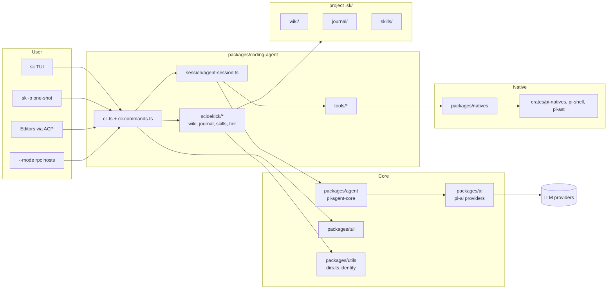
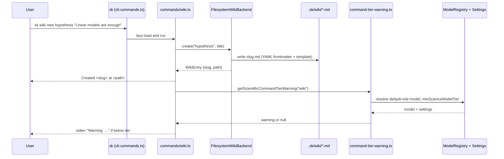

# Architecture Overview

Scidekick is a Bun workspaces monorepo. Most of the code is the inherited Oh My Pi harness (package scope `@oh-my-pi/*`, version `15.8.2`); the Scidekick-specific layer is small and concentrated in `packages/coding-agent/src/scidekick/`, `packages/coding-agent/src/commands/` and the identity defaults in `packages/utils/src/dirs.ts`.

## Design principles in current implementation

1. **Fork, not plugin.** Scidekick is a direct fork of Oh My Pi. Package names keep the `@oh-my-pi/*` scope so upstream merges stay mechanical; product identity (`sk`, `.sk`, `scidekick`) is changed through defaults and env overrides in `packages/utils/src/dirs.ts` instead of a deep rename.
2. **Research memory is plain files in the repo.** The wiki and journal are Markdown with YAML frontmatter under `.sk/`, so they can be committed, diffed and reviewed like code. There is no hidden database for research content.
3. **Scientific reliability is a guardrail, not a prompt.** The model-tier classifier and the skill validation gate encode empirical findings (AutoScientists 2026 on sub-Sonnet models; SkillLens 2026 on negative transfer of unvalidated skills) as code paths that emit warnings.
4. **Roadmap is labeled as roadmap.** `sk experiment`, `sk run`, `sk loop`, `sk pipeline` and `sk team` are described in `docs/scidekick-science-surface.md` but are not implemented; the README and this wiki only document wired commands.
5. **Prompts live in static files.** Per `AGENTS.md`, prompts are `.md` files imported with `with { type: "text" }` — the wiki entity templates in `packages/coding-agent/src/wiki-schemas/` follow the same rule.

## Main module boundaries

- `packages/coding-agent/src/cli.ts`: binary entry point (the `sk` bin in `packages/coding-agent/package.json`)
- `packages/coding-agent/src/cli-commands.ts`: lazy subcommand registry (`wiki`, `journal`, `install-skills`, `acp`, `acp-install`, …)
- `packages/coding-agent/src/commands/`: one file per subcommand (`wiki.ts`, `journal.ts`, `install-skills.ts`, `acp-install.ts`, …)
- `packages/coding-agent/src/scidekick/`: Scidekick backends — `wiki-backend.ts`, `journal-backend.ts`, `install-skills.ts`, `skill-registry.ts`, `model-tier.ts`, `command-tier-warning.ts`
- `packages/coding-agent/src/wiki-schemas/`: Markdown templates for wiki entity types
- `packages/coding-agent/src/session/agent-session.ts`: session runtime; hosts the skill validation gate
- `packages/coding-agent/src/config/settings-schema.ts`: settings schema, including `minScienceModelTier` and `scienceTierEnforcement`
- `packages/coding-agent/src/tools/`: built-in agent tools (`read`, `search`, `edit`, `bash`, `eval`, `lsp`, `debug`, `browser`, `task`, …)
- `packages/utils/src/dirs.ts`: `APP_NAME`, `CONFIG_DIR_NAME`, `VERSION`, agent/project directory helpers
- `packages/scidekick-*/`: standalone `@scidekick/guard|science|skills` packages (version `1.1.0`). They predate the in-tree copies in `coding-agent/src/scidekick/` and are not imported by the CLI; treat the in-tree copies as authoritative.

## Typical flow: a scientific CLI command

## Related pages

- [Research Wiki and Journal](Research-Wiki-and-Journal)
- [Scientific Skills and Model-Tier Guard](Scientific-Skills-and-Model-Tier-Guard)
- [Upstream Fork and Vendor Sync](Upstream-Fork-and-Vendor-Sync)
