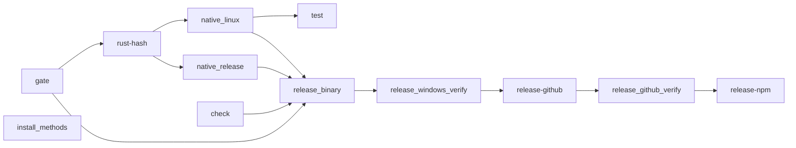

# Build, CI and Release

Local development commands, the GitHub Actions pipeline in `.github/workflows/ci.yml`, how `sk-*` release binaries are produced, and the GitHub Pages site.

## Local development

Requires Bun `1.3.14` (`packageManager` in the root `package.json`) and, for native work, the Rust toolchain pinned in `rust-toolchain.toml`.

| Command | What it does |
|---|---|
| `bun install` | Install workspace dependencies |
| `bun run dev` | Run the CLI from source (`packages/coding-agent/src/cli.ts`) |
| `bun run install:dev` | Install, then `bun link` `coding-agent` and `ai` so `sk` is on `PATH` |
| `bun run check` | `check:ts` (Biome + per-package checks, `tsgo` type check) and `check:rs` in parallel |
| `bun run test` | `test:ts` (`bun test` per workspace) then `test:rs` |
| `bun run build:native` | Build the Rust N-API addon (`packages/natives`) |
| `bun run build:site` | Build the docs site from `docs/scidekick-user-guide.md` (`scripts/build-site-docs.ts`) |
| `bun run fix` / `bun run fmt` | Auto-fix / format TS and Rust |
| `bun --cwd=packages/coding-agent run test` | Focused coding-agent tests |

Scidekick-specific tests live in `packages/coding-agent/test/`: `scidekick-commands.test.ts` (wiki/journal/install-skills CLI), `scidekick-identity.test.ts` (`sk`/`.sk` identity) and `scidekick-model-tier.test.ts` (tier classifier and decisions). The standalone `packages/scidekick-*` packages have their own `test/` folders.

Code rules for contributors (no `any`, ES `#private` fields, prompts in `.md` files, Bun APIs over Node, worker-script pattern for compiled binaries) are in `AGENTS.md`. `docs/using-sk-to-dev-sk.md` describes developing Scidekick with Scidekick.

## CI pipeline

Runs on pushes and pull requests to `main`, and by manual dispatch (`skip_npm` input).



| Job | Role |
|---|---|
| `gate` | Decides whether this run is a release: HEAD carries a `v*` tag, or a manual dispatch from a `v*` ref |
| `rust-hash` | Hashes the Rust sources and looks for a prior `main` build with matching native artifacts to reuse |
| `native_linux` / `native_release` | Build the N-API addon (Linux x64; release matrix: Linux arm64, macOS x64/arm64, Windows x64) when no reusable artifact exists or on release |
| `check` | `bun run ci:check:full` |
| `test` | `bun run test:ts` and `bun run ci:test:smoke` (`--version`, `--help`, `stats --help`, `doctor --json`, `--smoke-test`) |
| `install_methods` | Installer smoke tests (`scripts/install-tests/`) |
| `release_binary` | Builds and smoke-tests `sk-linux-x64`, `sk-linux-arm64`, `sk-darwin-x64`, `sk-darwin-arm64`, `sk-windows-x64.exe` |
| `release_windows_verify` | Runs the PowerShell installer against the built Windows binary |
| `release-github` / `release_github_verify` | Release notes from the package CHANGELOGs, integrity assets, GitHub Release, then verification |
| `release-npm` | npm publish with trusted publishing; skipped with `skip_npm` |

## Cutting a release

```bash
bun scripts/release.ts <version>   # preflight, bump, changelog, commit, atomic push of main + tag
bun scripts/release.ts watch       # follow CI for the current commit
```

The script pushes the bump commit and its `v*` tag together with `git push --atomic origin main refs/tags/v*`. CI is triggered by the branch push, not the tag ref, and `gate` reads the tag from HEAD. Release notes come from `packages/*/CHANGELOG.md`; the root `CHANGELOG.md` carries the Scidekick-level entries.

Installers (`scripts/install.sh`, `scripts/install.ps1`) download `sk-*` binaries from the GitHub Releases of `felippe-alves/scidekick` (the `REPO` variable); `--source`, `--binary` and `--ref` change the install mode.

## Site

`.github/workflows/site.yml` deploys `site/` to GitHub Pages. It runs on pushes to `main` that touch `site/**`, `docs/scidekick-user-guide.md`, `scripts/build-site-docs.ts`, `package.json`, `bun.lock` or the workflow file. It runs `bun install --frozen-lockfile` and `bun run build:site`, then publishes.

## Related pages

- [Upstream Fork and Vendor Sync](Upstream-Fork-and-Vendor-Sync)
- [Architecture Overview](Architecture-Overview)
- [Troubleshooting](Troubleshooting)
