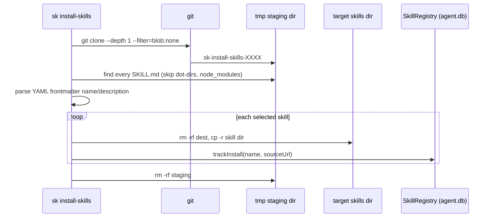

# Scientific Skills and Model-Tier Guard

Scidekick treats domain skills and model choice as reliability problems. This page covers the skill installer, the SQLite skill registry, the skill validation gate and the model-tier classifier — all in `packages/coding-agent/src/scidekick/`.

## Installing skills: `sk install-skills` (alias `sk skills`)

Command: `packages/coding-agent/src/commands/install-skills.ts`. Logic: `runInstallSkills` in `scidekick/install-skills.ts`.

| Flag / arg | Meaning |
|---|---|
| `[repo]` or `--from <repo>` | Source. `https://…` used as-is; `owner/name` expands to `https://github.com/owner/name`; anything else is resolved as a local path |
| `--list` | List skills found in the repo; install nothing |
| `--skill <name>` | Install only the named skill(s) |
| `--project` | Install into `<project>/.sk/skills/` instead of the user agent dir `~/.sk/agent/skills/` |

Default repository: `DEFAULT_SKILLS_REPO = "https://github.com/felippe-alves/scientific-agent-skills"`.



The skill name comes from the `name` field in `SKILL.md` frontmatter, falling back to the directory name; the destination directory is the sanitized name. Re-installing replaces the directory entirely.

## Skill registry

`SkillRegistry` (`scidekick/skill-registry.ts`) is a `bun:sqlite` table `skill_metadata` in the agent database (`getAgentDbPath()`, i.e. `agent.db` in the agent data dir), opened in WAL mode:

| Column | Type | Purpose |
|---|---|---|
| `name` | TEXT | Skill name (PK part) |
| `source_url` | TEXT | Repository it came from (PK part) |
| `installed_at` | INTEGER | Unix seconds |
| `validated_models` | TEXT | JSON array of model IDs the skill has been validated with |
| `performance_delta` | REAL | Measured effect of the skill (nullable) |
| `rubric_score` | REAL | Rubric score (nullable) |

API: `trackInstall`, `trackUninstall`, `recordValidation`, `getUnvalidatedSkills(modelId)`, `isValidated(name, modelId)`. Nothing in the CLI calls `recordValidation` yet — there is no validation benchmark — so every installed skill counts as unvalidated for every model.

## Skill validation gate

In the `AgentSession` constructor (`session/agent-session.ts`), when skills are loaded, each loaded skill that appears in `getUnvalidatedSkills(currentModel.id)` adds a config warning:

```text
Skill "<name>" not validated for model <model-id>. Performance may vary.
```

The rationale (SkillLens, MSR 2026) is that about 25% of extractor/target skill pairs show negative transfer. Only skills installed through `install-skills` are in the registry, so skills that arrive by other routes never trigger the warning.

## Model-tier classifier

`classifyModelTier` (`scidekick/model-tier.ts`) maps a model ID to `haiku | sonnet | opus` with regex heuristics, so new models classify without a hardcoded list:

| Tier | Matches (summary) |
|---|---|
| `opus` | `opus`; IDs starting `claude-4`; `gpt-5*` except `mini`/`nano`; `gemini-*ultra`; `grok-3` |
| `haiku` | `haiku`; `flash` (unless `thinking`/`pro`); `mini`, `nano`, `lite` suffixes; `3b`/`7b`/`8b`/`9b`; `gpt-3.5`; `gpt-4(.1)-mini`; `claude-instant`; `command-r` (not plus); `codestral` (not pro); Ollama models under 20B |
| `sonnet` | everything else (conservative default to avoid false positives) |

Settings (`config/settings-schema.ts`, Model tab):

| Key | Values | Default |
|---|---|---|
| `minScienceModelTier` | `haiku`, `sonnet`, `opus` | `sonnet` |
| `scienceTierEnforcement` | `warn`, `block` | `warn` |

`detectScienceContext` recognizes three context kinds: a scientific command (`wiki`, `journal`, `install-skills`), a scientific system prompt (contains `scidekick`, or at least two of the markers `scientific`, `science`, `research`, `hypothesis`, `experiment`, `evidence`, `literature`, `paper`, `protocol`), or loaded scientific skills (prefixes such as `scientific-`, `research-`, `paper-`, or names like `literature-review`, `peer-review`). `evaluateScienceTierDecision` returns a message when the model is below the minimum.

### What is wired today

- The only runtime caller is `scidekick/command-tier-warning.ts`, used by the `wiki`, `journal` and `install-skills` commands. It resolves the `default` role model and prints the warning on stderr.
- For the `scientific-command` context the enforcement is always downgraded to `warn`, so `scienceTierEnforcement: block` has no effect on these commands.
- The prompt and skills contexts (and therefore `block`) are implemented and unit-tested (`test/scidekick-model-tier.test.ts`) but not yet called from the interactive session.
- The `--no-tier-check` flag exists only in the standalone `packages/scidekick-guard/model-tier.ts` and is not parsed by the CLI.

## Related pages

- [Research Wiki and Journal](Research-Wiki-and-Journal)
- [Configuration and Identity](Configuration-and-Identity)
- [Troubleshooting](Troubleshooting)
