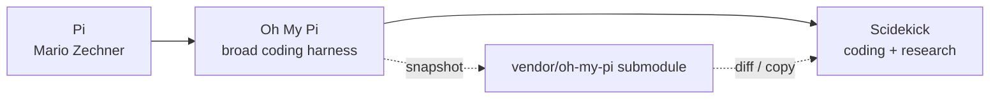

# Upstream Fork and Vendor Sync

Scidekick is a direct fork of Oh My Pi. Forked packages keep their upstream names (`@oh-my-pi/pi-coding-agent`, `@oh-my-pi/pi-ai`, …) and versions; Scidekick changes are carried as a patch on top. This page explains how upstream changes are brought in.

## Lineage

## The `vendor/oh-my-pi` submodule

Declared in `.gitmodules`:

| Field | Value |
|---|---|
| path | `vendor/oh-my-pi` |
| url | `https://github.com/felippe-alves/scidekick.git` |
| branch | `vendor/oh-my-pi` |

It holds a pristine-ish upstream snapshot so the fork patch can be computed as `vendor/oh-my-pi/packages/<pkg>/src` vs `packages/<pkg>/src`. It is not needed to build or run `sk`; only the merge tooling below reads it.

Pointer history in the main repo:

| Commit | Submodule pointer | Upstream version |
|---|---|---|
| `80e670082` (2026-05-31) | `4b237ce` — tip of branch `vendor/oh-my-pi` | `15.7.3` |
| `aef927377` (2026-06-03) "fast-forward … to upstream 15.8.2" | `b6f9b29` | `15.8.2` |

As of 2026-11-06, `b6f9b29` is not on the remote: `git submodule update --init` fails with `not our ref`. Only `4b237ce` (15.7.3) can be fetched. See [Troubleshooting](Troubleshooting).

## Merge tooling

| Script | What it does |
|---|---|
| `scripts/check-upstream-safety.ts` | For each forked `@oh-my-pi/*` package, diffs vendor vs fork and reports the Scidekick-modified files, whether vendor is behind upstream, and overlaps between upstream changes and the fork patch. Flags: `--fetch` (fetch upstream first), `--json` |
| `scripts/sync-vendor-version.ts` | Reads `vendor/oh-my-pi/package.json#workspaces.catalog` and rewrites each forked `package.json` plus the root catalog to those versions. `--dry-run` previews |
| `scripts/sync-versions.ts`, `scripts/check-spoofed-versions.ts` | Keep workspace versions consistent |

`sync-vendor-version.ts` treats the vendor catalog as authoritative. Running it against the 15.7.3 snapshot would downgrade the `15.8.2` versions now in `package.json`; run it with `--dry-run` first.

## Merge process

The last merge (15.7.3 → 15.8.2) is planned in `docs/pi-coding-agent-merge-plan.md`. It sorts `pi-coding-agent` files into four groups: pure-upstream files (copy from vendor), new vendor files (add), Scidekick-only files (keep, check for conflicts) and Scidekick-modified files (147, merged in batches by diff size). Commit `937ee6c96` records a partial merge of `pi-coding-agent` and a full update of `pi-ai`. Lower-risk packages were fast-forwarded earlier in `aef927377`.

Scidekick-only code to protect during merges:

- `packages/coding-agent/src/scidekick/`
- `packages/coding-agent/src/commands/{wiki,journal,install-skills,acp-install}.ts`
- `packages/coding-agent/src/wiki-schemas/`
- the skill validation gate in `session/agent-session.ts`
- the science keys in `config/settings-schema.ts`
- identity defaults in `packages/utils/src/dirs.ts`

## Related pages

- [Architecture Overview](Architecture-Overview)
- [Build, CI and Release](Build-CI-and-Release)
- [Troubleshooting](Troubleshooting)
